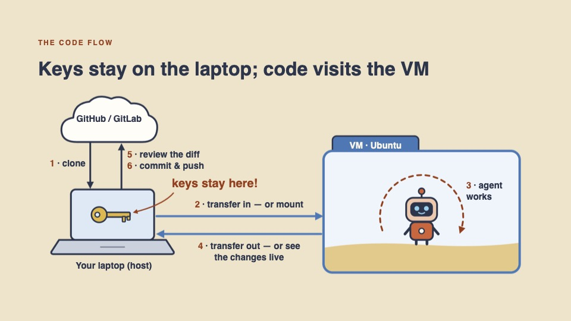

# 2. Sandboxing with Multipass

[← 1. AI in VS Code](1-ai-in-vscode.md) · [Back to overview](../README.md)

Here the coding agent runs inside an **Ubuntu virtual machine (VM)**. It can install, delete and run anything, but only inside the VM. The VM has its own Linux kernel and operating system, so everything inside it works the same whatever laptop you have.

- [Pick an approach](#pick-an-approach)
- [Step 1: Clone your project on your laptop](#step-1-clone-your-project-on-your-laptop)
- [Step 2: Create the VM](#step-2-create-the-vm)
- [Step 3a: Pure VM, copying files in and out](#step-3a-pure-vm-copying-files-in-and-out)
- [Step 3b: VM with mount, sharing the folder](#step-3b-vm-with-mount-sharing-the-folder)
- [Step 4: Set up the agent inside the VM](#step-4-set-up-the-agent-inside-the-vm)
- [Step 5: Review and keep the changes](#step-5-review-and-keep-the-changes)
- [Step 6: Clean up](#step-6-clean-up)
- [Troubleshooting](#troubleshooting)

NOTE: In the following examples, the project folder is `EMBL-phd-symposium-workshop` inside `Documents`, and the VM is called `test`. 

---

## Pick an approach

| | Pure VM | VM with mount |
|---|---|---|
| How the code enters the VM | You copy it in and back out with `multipass transfer` | You mount your project folder |
| When you see the changes inside of the VM | After you copy them back | Immediately, in VS Code on your laptop |
| If the agent deletes files | Only the copy in the VM is affected | They're deleted on your laptop too (Git can restore what you committed) |
| Isolation | Strongest | Strong, except for that one folder |

> [!WARNING]
> As seen in the table above, if you mount your project folder, the changes within the VM are applied on your laptop project folder as well. This is why you should always have Git tracking your project and commit changes before you run the agent. If you want to be extra safe, use the pure VM approach.

Whatever you choose, here is a general workflow illustrated in images:



> [!WARNING]
> Your Git credentials (SSH keys, tokens) should never go into the VM, so even a misbehaving agent can't push to your repositories.

---

## Step 1: Clone your project on your laptop

```bash
cd ~/Documents
git clone <your-repository-url> EMBL-phd-symposium-workshop
```

On Windows, run the same in PowerShell with `cd $HOME\Documents` as the first line.

---

## Step 2: Create the VM

### With the Multipass app

1. Open Multipass and choose **Ubuntu Server**, one of the **LTS** releases.
2. Click **Configure**:
   - **CPUs:** at least 2
   - **Memory:** about 4 GB
   - **Disk:** at least 20 GB
   - **Mount** (only for the mount approach, macOS and Linux): add your **project folder only**. On Windows, mount from the terminal instead ([Step 3b](#step-3b-vm-with-mount-sharing-the-folder)).
3. Click **Save**, then **Launch**. The VM starts automatically.
4. Under **Instances**, click the VM's name and open its **shell**.

### Or with the terminal

```bash
multipass launch lts --name test --cpus 2 --memory 4G --disk 20G
```

This creates the VM and starts it. To open a terminal inside it:

```bash
multipass shell test
```

Type `exit` to leave the VM again.

> [!TIP]
> **What the resources cost:** CPUs are only used while the VM is busy. Memory is reserved as long as the VM is running; `multipass stop test` frees CPU and memory. The disk stays used until you delete the VM.
> You should always stop the VM when you don't need it, and delete it when you're done with the project.

### Useful commands

| Command | What it does |
|---|---|
| `multipass shell test` | Open a terminal inside the VM (`exit` to leave) |
| `multipass list` | Show your VMs and whether they're running |
| `multipass stop test` / `multipass start test` | Stop the VM to free CPU and memory, or start it again |
| `multipass snapshot test` | Save the VM's current state (stop it first) |
| `multipass restore test.snapshot1` | Go back to a saved state (stop it first) |
| `multipass transfer` | Copy files in or out ([Step 3a](#step-3a-pure-vm-copying-files-in-and-out)) |
| `multipass mount` / `multipass umount` | Share a folder, or stop sharing it ([Step 3b](#step-3b-vm-with-mount-sharing-the-folder)) |
| `multipass delete --purge test` | Delete the VM and free its disk |
| `multipass help <command>` | Show all options of a command |

---

## Step 3a: Pure VM, copying files in and out

Run these commands **on your laptop**, in a new terminal (not inside the VM), from the folder that contains your project.

**Copy your project into the VM:**

```bash
# macOS and Linux
cd ~/Documents
multipass transfer --recursive EMBL-phd-symposium-workshop test:.
```

```powershell
# Windows (PowerShell)
cd $HOME\Documents
multipass transfer --recursive EMBL-phd-symposium-workshop test:.
```

Inside the VM, `ls` should now show `EMBL-phd-symposium-workshop`. From now on, changes in the VM **don't** reach your laptop until you copy them back.

**When the agent is done, copy the folder back:**

```bash
# macOS and Linux
cd ~/Documents
multipass transfer --recursive test:EMBL-phd-symposium-workshop .
```

```powershell
# Windows (PowerShell)
cd $HOME\Documents
multipass transfer --recursive test:EMBL-phd-symposium-workshop .
```

Git on your laptop now shows what changed, and you can decide what to commit and push ([Step 5](#step-5-review-and-keep-the-changes)).

> [!NOTE]
> - **It's a copy, not a sync.** Files the agent deleted inside the VM are **not** deleted on your laptop, so `git status` won't show those deletions.
> - The copy includes the VM's `.git` folder. Check `.git/hooks` before you commit (see [Step 5](#step-5-review-and-keep-the-changes)).
> - If you end up with a nested `EMBL-phd-symposium-workshop/EMBL-phd-symposium-workshop` folder, delete the inner copy and copy back into the **parent** folder.

---

## Step 3b: VM with mount, sharing the folder

With a mount, your project folder appears inside the VM. You see every change the agent makes right away, and Git on your laptop tracks it, so you decide what to keep.

**Mount only your project folder, never your home folder.** The agent can change or delete everything in the mounted folder.

### macOS and Linux

Either mount when you create the VM:

```bash
multipass launch lts --name test --cpus 2 --memory 4G --disk 20G \
  --mount ~/Documents/EMBL-phd-symposium-workshop:/home/ubuntu/EMBL-phd-symposium-workshop
```

or mount into an existing VM:

```bash
multipass mount ~/Documents/EMBL-phd-symposium-workshop test:/home/ubuntu/EMBL-phd-symposium-workshop
```

### Windows

Mounts are **turned off by default on Windows**. Turn them on, then mount into the VM after creating it:

```powershell
multipass set local.privileged-mounts=true
multipass mount "$HOME\Documents\EMBL-phd-symposium-workshop" test:/home/ubuntu/EMBL-phd-symposium-workshop
```

> [!CAUTION]
> On Windows, turn mounts off again when you no longer need them: `multipass set local.privileged-mounts=false`.

### Stop sharing

```bash
multipass umount test
```

> [!TIP]
> To avoid switching between VS Code and a separate terminal, open VS Code's integrated terminal and run `multipass shell test` there. A Multipass extension for VS Code (for example *Multipass Run*) is needed for this.

---

## Step 4: Set up the agent inside the VM

All commands in this step run **inside the VM** (`multipass shell test`), unless marked "on your laptop". The VM is Ubuntu for everyone, so this is the same on every laptop.

### Option A: OpenCode (recommended)

1. **Install OpenCode.** On <https://opencode.ai/>, copy the command from the **Terminal** install option. 
2. The installer adds OpenCode to your `PATH` without asking. To use it, type `exit` and run `multipass shell test` again, or run the `export PATH=…` line the installer prints.
3. **Copy our VM configuration in.** On your laptop, from the folder where you cloned this repository:
   ```bash
   multipass transfer --parents configs/opencode/opencode.vm.json test:.config/opencode/opencode.json
   ```
   This config sets up Blablador and de.NBI and lets the agent work **without asking for permission**, which is fine inside the VM. If the folder does not exist, create it first: `mkdir -p ~/.config/opencode`.
4. **Install the Blablador plugin** (inside the VM): Alternatively, to set up Blablador, run this command inside the VM:
   ```bash
   opencode plugin add opencode-blablador
   ```
5. **Add your API key.** Start OpenCode with `opencode`, type `/connect`, search for **Blablador** (or **denbi**) and paste your key. Or, before starting OpenCode:
   ```bash
   opencode auth login blablador --method key
   opencode auth login denbi --method key
   ```
6. **Choose a model** with `/models`.
7. **Work in your project:** `cd EMBL-phd-symposium-workshop`, then `opencode`. Press **Tab** for the Plan agent, read its plan, then let it build.

### Option B: GitHub Copilot CLI

1. **Install it:**
   ```bash
   curl -fsSL https://gh.io/copilot-install | bash
   ```
   When asked *"Would you like to add it to /home/ubuntu/.profile? [y/N]"*, answer **y**. Then type `exit` and run `multipass shell test` again, or run the `export` line it prints.
2. **Quick setup.** Run these in each new shell, then start `copilot`. With your own key you don't need to sign in to GitHub.

   **Blablador:**
   ```bash
   export COPILOT_PROVIDER_BASE_URL="https://api.blablador.fz-juelich.de/v1"
   export COPILOT_PROVIDER_TYPE="openai"
   export COPILOT_PROVIDER_WIRE_API="completions"
   export COPILOT_MODEL="alias-large"
   read -rsp "Paste your Blablador API key: " COPILOT_PROVIDER_API_KEY; echo
   export COPILOT_PROVIDER_API_KEY
   ```

   **de.NBI:**
   ```bash
   export COPILOT_PROVIDER_BASE_URL="https://llm.bi.denbi.de/v1"
   export COPILOT_PROVIDER_TYPE="openai"
   export COPILOT_PROVIDER_WIRE_API="completions"
   export COPILOT_MODEL="vllm/Qwen/Qwen3.8-27B"
   read -rsp "Paste your de.NBI API key: " COPILOT_PROVIDER_API_KEY; echo
   export COPILOT_PROVIDER_API_KEY
   ```

   `read -rsp` hides the key while you paste it and keeps it out of your shell history. The settings last until you close the shell. 

---

## Step 5: Review and keep the changes

Do this **on your laptop**, in your project folder:

1. See what changed:
   ```bash
   git status
   git diff
   ```
   Or use VS Code's Source Control view or Git Graph.
2. Check for files Git doesn't show you. Scripts in `.git/hooks` run **on your laptop** the next time you commit, and `git diff` never shows them. You should see only files ending in `.sample`:
   ```bash
   ls .git/hooks          # macOS and Linux
   ```
   ```powershell
   Get-ChildItem .git\hooks   # Windows
   ```
3. Look out for new install scripts, new dependencies (for example in `requirements.txt` or `package.json`) and new `.vscode/` settings. Try new code inside the VM first, not on your laptop.
4. Commit and push **from your laptop**.

---

## Step 6: Clean up

```bash
multipass stop test             # frees CPU and memory
multipass delete --purge test   # removes the VM and frees its disk
```

> [!WARNING]
> Only delete the VM when you're done with the project. If you want to keep it for later, just stop it.

Before a big task, a snapshot is a cheap undo button: `multipass stop test`, then `multipass snapshot test`. Later, `multipass restore test.snapshot1` takes the VM back.

---

[← 1. AI in VS Code](1-ai-in-vscode.md) · [Back to overview](../README.md) · [Security checklist](security-checklist.md)
